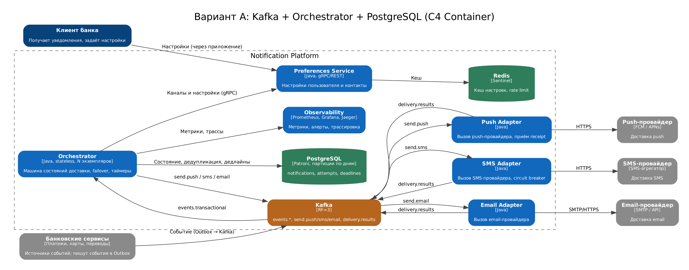
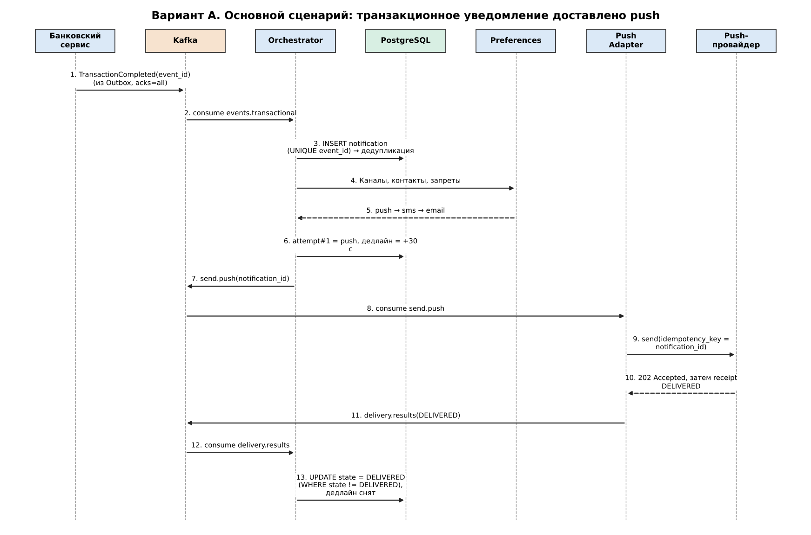
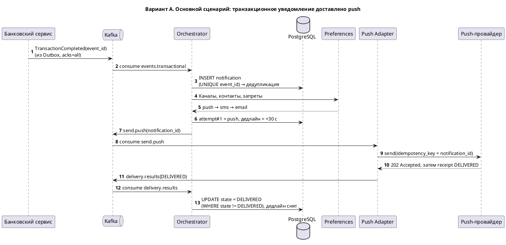
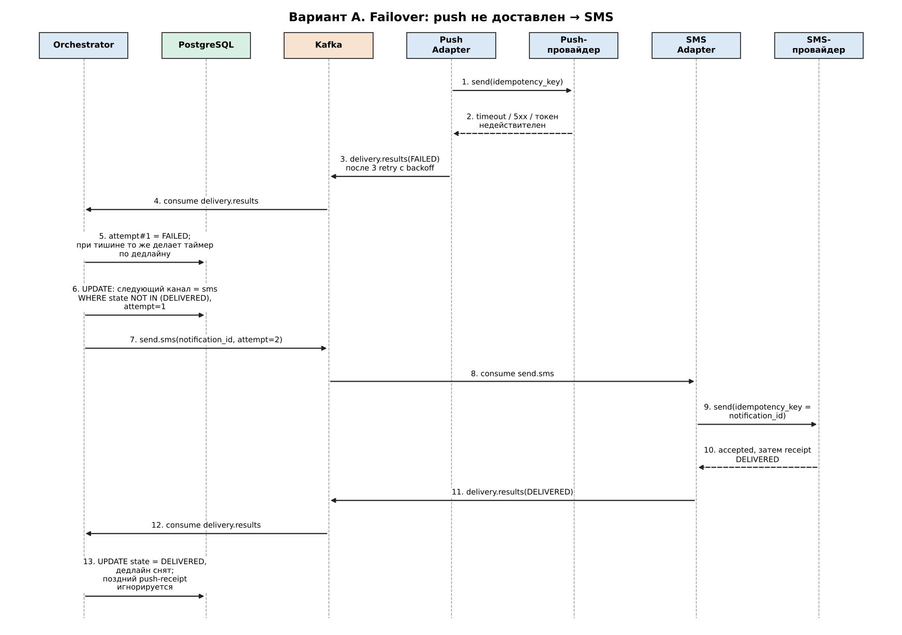
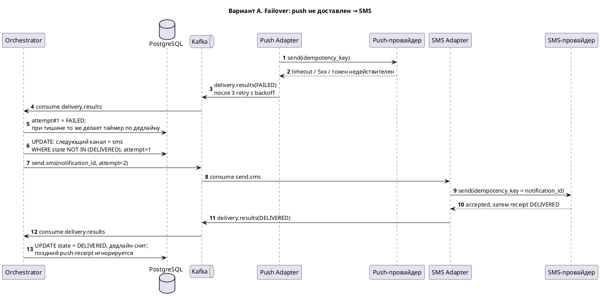
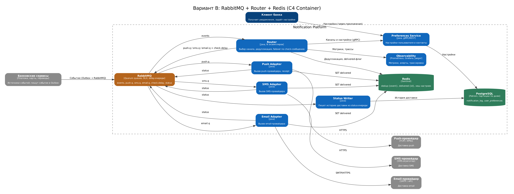
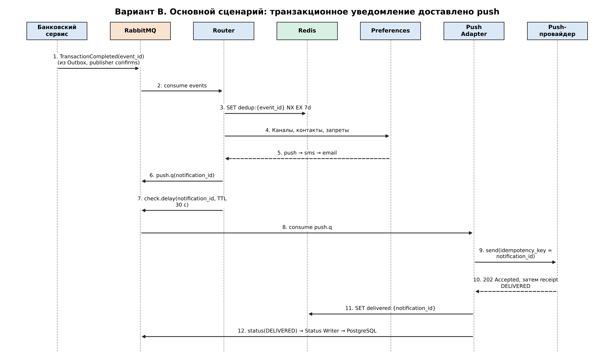
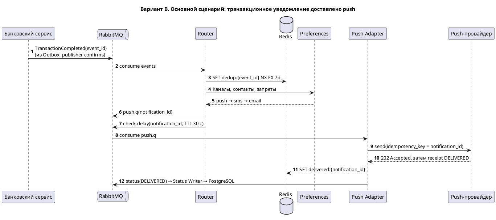
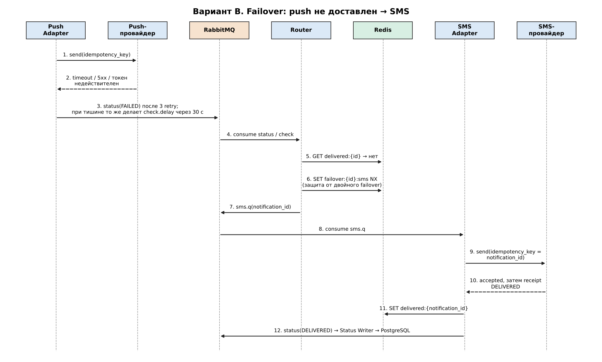
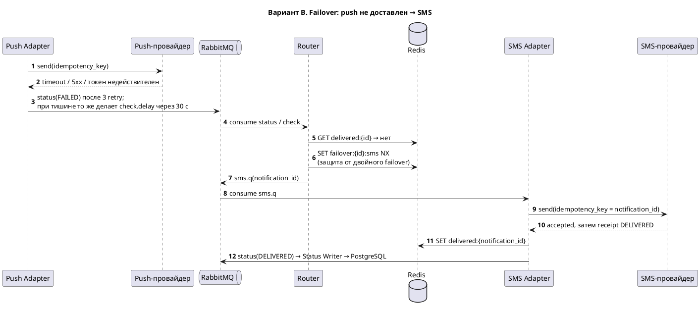

## 1. Функциональные требования

| ID | Требование | Бизнес-цель |
|---|---|---|
| FR1 | Платформа принимает событие от банковского сервиса и создаёт по нему уведомление нужного типа (транзакционное, сервисное, маркетинговое). | Единая точка отправки |
| FR2 | Платформа доставляет критичное уведомление пользователю хотя бы по одному каналу (push, SMS, email) в порядке приоритета. | Гарантия доставки критичных |
| FR3 | Если доставка по каналу не подтверждена, платформа автоматически переходит на следующий канал (push → SMS → email). | Гарантия доставки, −30% жалоб |
| FR4 | Пользователь настраивает предпочтительный канал и отключает сервисные и маркетинговые уведомления. Транзакционные отключить нельзя: можно поменять порядок каналов, но хотя бы один канал остаётся включённым. | Удержание +15%, требования закона и безопасности |
| FR5 | Маркетинг запускает кампанию на сегмент до 1 млн получателей; кампания уходит только тем, кто не отказался от маркетинга. | Удержание +15% |
| FR6 | Пользователь и поддержка видят историю уведомлений: тип, канал, статус (создано, отправлено, доставлено, ошибка), время. | −30% жалоб (быстро разбирать обращения) |
| FR7 | Одно событие даёт не более одного уведомления для пользователя, в том числе при повторной обработке события и при failover. | Доверие клиентов, −30% жалоб |

## 2. Нефункциональные требования

| ID | Требование | Метрика |
|---|---|---|
| NFR1 | Латентность транзакционных | p99 от события до передачи push провайдеру ≤ 5 с. Если push не подтверждён, SMS передаётся провайдеру ≤ 45 с от события (ожидание push 30 с + переход) |
| NFR2 | Пропускная способность | ≥ 5 000 уведомлений/с суммарно, из них транзакционные ≥ 2 000/с. Кампания на 1 млн уходит ≤ 30 мин (≈ 556/с) и не замедляет транзакционные |
| NFR3 | Доступность приёма и маршрутизации транзакционных | 99,95% в месяц (≈ 22 мин простоя) |
| NFR4 | Надёжность | Потеря принятого события: 0. Не менее 99,9% критичных уведомлений доставлено хотя бы одним каналом за 5 мин (при исправных провайдерах) |
| NFR5 | Дубликаты | Не более 0,1% уведомлений доставлено пользователю дважды |
| NFR6 | Масштабируемость | Рост нагрузки в 3 раза (DAU 9 млн) решается добавлением экземпляров и партиций без переделки архитектуры |
| NFR7 | Наблюдаемость | Путь любого уведомления по `notification_id` находится ≤ 1 мин; алерт «доля неуспешных доставок > 2% за 5 мин» срабатывает ≤ 2 мин |
| NFR8 | Стоимость | SMS не более 5% от транзакционных уведомлений в штатном режиме (SMS только как failover) |
| NFR9 | Хранение | История уведомлений 90 дней |

## 3. Архитектурно значимые требования (ASR)

| ID | ASR | Приоритет | Связанные требования | Почему влияет на архитектуру |
|---|---|---|---|---|
| ASR1 | Гарантированная доставка критичных с автоматическим failover между каналами | Высокий | FR2, FR3, NFR1, NFR3, NFR4 | Нужно знать, дошло ли уведомление, помнить это состояние и надёжно принимать решение о смене канала. Это определяет, где хранится состояние и кто управляет доставкой |
| ASR2 | Нет потерь и дублей при сбоях, повторах и failover | Высокий | FR7, NFR4, NFR5 | Брокеры дают «минимум один раз», значит дубли неизбежны. Нужны идемпотентность на каждом шаге и атомарная передача события в брокер |
| ASR3 | Изоляция и масштабирование: кампании и сбой одного провайдера не замедляют транзакционные | Высокий | FR5, NFR1, NFR2, NFR6 | Нужны раздельные потоки для типов уведомлений и независимое масштабирование потребителей |
| ASR4 | Управляемая стоимость каналов и уважение настроек пользователя | Средний | FR4, NFR8 | SMS дороже push, поэтому канал выбирается по настройкам и стоимости, а SMS включается только при необходимости |
| ASR5 | Наблюдаемость доставки | Средний | FR6, NFR7 | Нужны единый идентификатор, метрики по каналам и журнал попыток |

## 4. Ключевые архитектурные вопросы

| ID | Вопрос | Порождён | Почему важен |
|---|---|---|---|
| Q1 | Где хранится состояние доставки и кто решает о failover: центральный оркестратор или распределённая цепочка (хореография)? | ASR1, ASR2 | От этого зависит надёжность решения «слать ли SMS» и риск двойной отправки |
| Q2 | Как гарантировать «не терять и не дублировать» между банковским сервисом, брокером и провайдерами? | ASR2 | Ошибка здесь даёт потерянные списания или двойные SMS (деньги и жалобы) |
| Q3 | Как разделить потоки транзакционных, сервисных и маркетинговых уведомлений? | ASR3 | Кампания на 1 млн не должна задерживать «с вашей карты списано» |
| Q4 | Как определять «не доставлено» и сколько ждать перед переходом на следующий канал? | ASR1, ASR4 | Слишком короткое ожидание даёт лишние дорогие SMS и дубли, слишком длинное нарушает NFR1 |

## 5. Архитектурные последствия ASR

| ASR | Последствия |
|---|---|
| ASR1 | Состояние каждого уведомления хранится в **надёжном хранилище** (PostgreSQL), а не в памяти. Есть **таймер/дедлайн** на каждую попытку. Адаптеры каналов возвращают подтверждение доставки (receipt). Провайдеры защищены **circuit breaker**: если push-провайдер недоступен, уведомление сразу идёт в SMS |
| ASR2 | **Transactional Outbox** в банковском сервисе (событие пишется в одной транзакции с бизнес-данными). Брокер с подтверждением записи (acks=all / publisher confirms). **Идемпотентные потребители**: UNIQUE по `event_id`, ключ идемпотентности `notification_id` для провайдеров, условное обновление состояния. **Retry с exponential backoff**, DLQ для необработанных |
| ASR3 | **Раздельные топики/очереди** по типу и по каналу, раздельные группы потребителей, квоты на кампании. Все сервисы без состояния, масштабируются горизонтально. Для кампаний включён ограничитель скорости (rate limit) |
| ASR4 | Сервис настроек (**Preferences**) с кешем. Порядок каналов: дешёвый первым (push → email/SMS по настройкам). SMS включается только по результату попытки, а не параллельно. Метрика доли SMS |
| ASR5 | `notification_id` сквозной в логах, метриках и трассировке. Таблица попыток доставки. Метрики по каналам, алерты по доле ошибок, лаг очередей |

## 6. Неподходящие решения

| ID | Решение | Какой ASR нарушает | Почему не подходит |
|---|---|---|---|
| X1 | Банковский сервис сам синхронно вызывает push/SMS-провайдера внутри операции (перевода) | ASR1, ASR3 | Сбой или медленный ответ провайдера тормозит или ломает платёж; нет состояния и повторов; при ошибке уведомление теряется |
| X2 | Одна общая очередь для всех типов уведомлений | ASR3 | Кампания на 1 млн (≈ 30 мин работы при 556/с) блокирует транзакционные, NFR1 нарушается |
| X3 | Отправлять сразу по всем каналам параллельно «для надёжности» | ASR2, ASR4 | Гарантированные дубли и расход на SMS каждому клиенту: ≈ 12 млн ₽/сутки вместо ≈ 0,6 млн ₽ (расчёт в п. 8.3) |
| X4 | Хранить состояние доставки только в памяти сервиса или в кеше без репликации | ASR1, ASR2 | Рестарт или сбой теряет информацию «доставлено или нет»: либо потеря, либо повторная отправка |

## 7. Неопределённости и риски

| ID | Что неизвестно | Чем грозит | Как проверить |
|---|---|---|---|
| R1 | Реальная доля недоставленных push и надёжность delivery receipt у FCM/APNs (для части устройств подтверждения доставки нет) | Лишние SMS или ложное «не доставлено» | Пилот на части трафика: измерить долю receipt и время их прихода; по результату подобрать таймаут 30 с |
| R2 | Лимиты, цена и SLA SMS-провайдера; поведение при массовом failover (падение push-провайдера: до 6 млн SMS в сутки) | Упор в лимиты провайдера, перерасход бюджета | Запросить SLA и лимиты, нагрузочный тест, лимит расходов (budget cap) и алерт |
| R3 | Допустимость редкого дубля (push доставился поздно, после SMS) и правила для SMS/согласий (закон, внутренние политики) | Жалобы клиентов, претензии | Согласовать с владельцем продукта и юристами, зафиксировать допустимую долю дублей (NFR5) |
| R4 | Коэффициент пика (в расчётах принят ×10 к среднему) и реальное число транзакционных на пользователя | Недо- или переразмеренная система | Взять реальные логи платёжных событий за 3 месяца и пересчитать п. 8.3 |

---

## 8. RFC-001: Гарантированная доставка критичных уведомлений с автоматическим failover между каналами

| | |
|---|---|
| Статус | Предложение (Draft) |
| Автор | (впишите ФИО) |
| Дата | 2026-11-17 |
| Затрагивает | Notification Platform, банковские сервисы (источники событий) |

### 8.1 Контекст и цель

Сейчас уведомления отправляются разрозненно, часть из них не доходит, и клиенты жалуются. Цель RFC: спроектировать механизм, который **гарантирует доставку хотя бы по одному каналу** для транзакционных уведомлений, **автоматически переходит** push → SMS → email, учитывает настройки пользователя, минимизирует стоимость, наблюдаем и не создаёт дублей.

Не цели: сегментация и редактор кампаний, шаблоны текстов, выбор конкретных SMS-провайдеров.

Требования и ASR: см. разделы 1–5 (FR1–FR7, NFR1–NFR9, ASR1–ASR5).

### 8.2 Общие принципы (для обоих вариантов)

- **Transactional Outbox.** Банковский сервис пишет событие в таблицу outbox в той же транзакции, что и бизнес-операцию; отдельный relay публикует его в брокер. Так событие не теряется и не публикуется, если операция откатилась.
- **Цепочка каналов** по умолчанию push → SMS → email; порядок и набор берутся из настроек пользователя (FR4). Для транзакционных хотя бы один канал всегда включён.
- **Ожидание перед failover:** 30 с на попытку push (допущение, уточняется в R1), в рамках 3 повторов с backoff 1, 2, 4 с на ошибках провайдера.
- **Идемпотентность:** `notification_id` = детерминированный хеш от `event_id`; в запросе к провайдеру он идёт как ключ идемпотентности (для push — `collapse_key` / `apns-collapse-id`).
- **Circuit breaker** на каждом провайдере: при открытом breaker канал пропускается сразу.

### 8.3 Масштаб и нагрузка (порядок величин)

Исходные: MAU 10 млн, DAU 3 млн, пик 300 000 одновременных пользователей; на пользователя в сутки: 2 транзакционных, 3 сервисных, 5 маркетинговых.

| Величина | Расчёт | Результат |
|---|---|---|
| Транзакционных в сутки | 3 000 000 × 2 | 6 млн |
| Сервисных в сутки | 3 000 000 × 3 | 9 млн |
| Маркетинговых в сутки | 3 000 000 × 5 | 15 млн |
| Всего в сутки | 6 + 9 + 15 | **30 млн** |
| Среднее, всего | 30 000 000 / 86 400 | ≈ **347/с** |
| Среднее, транзакционные | 6 000 000 / 86 400 | ≈ **69/с** |
| Пик, транзакционные (допущение ×10 к среднему) | 69 × 10 | ≈ **694/с** |
| Пик, всё вместе (×10) | 347 × 10 | ≈ **3 470/с** |
| Стресс-сценарий: все 300 000 онлайн-пользователей, по одной операции в 5 мин | 300 000 / 300 | **1 000/с** |
| Кампания 1 млн за 30 мин | 1 000 000 / 1 800 | ≈ **556/с** |
| Кампания 1 млн за 10 мин (для сравнения) | 1 000 000 / 600 | ≈ **1 667/с** |
| **Расчётная цель (с запасом ×2 к стрессу)** | транзакционные 2 000/с; суммарно 5 000/с | NFR2 |
| Сообщения в брокере (≈ 4 на уведомление: событие, команда, результат, receipt) | 3 470 × 4 | ≈ **14 000 сообщений/с** на пике |
| Объём в брокере в сутки | 30 млн × 1 КБ × RF 3 | ≈ **92 ГБ/сут**; хранение 3 суток ≈ 280 ГБ |
| Записи в PostgreSQL (только транзакционные, ≈ 4 записи на уведомление: insert + 2–3 update) | 2 000 × 4 | ≈ **8 000 записей/с** на цель |
| История (все типы), 1 КБ на уведомление | 30 млн × 1 КБ | ≈ **31 ГБ/сут**, 90 дней ≈ **2,8 ТБ** |
| Failover push → SMS при 5% недоставленных (допущение) | 6 млн × 5% | **300 000 SMS/сут**; на пике ≈ 35/с |
| Стоимость SMS (допущение 2 ₽/SMS): push-first | 300 000 × 2 | ≈ **0,6 млн ₽/сут** |
| Стоимость SMS: слать SMS всем транзакционным | 6 000 000 × 2 | ≈ **12 млн ₽/сут** (в 20 раз дороже) |
| Худший случай: падение push-провайдера на сутки | 6 млн × 2 ₽ | до 12 млн ₽/сут; ограничивается budget cap (R2) |

Вывод: нагрузка средняя по современным меркам: единицы тысяч сообщений в секунду. Главные трудности не в объёме, а в **гарантиях** (состояние, дубли, failover) и в **изоляции** кампаний от транзакционных.

---

### 8.4 Вариант A: Kafka + Orchestrator + PostgreSQL (состояние хранится централизованно)

**Идея.** Один сервис-оркестратор ведёт для каждого уведомления машину состояний в PostgreSQL и сам решает, когда переходить на следующий канал. Kafka — шина событий и команд. Адаптеры каналов — простые исполнители.

**Технологии.** Kafka (RF=3, `min.insync.replicas=2`, `acks=all`), PostgreSQL 16 с Patroni (синхронная реплика, партиции по дням), Redis Sentinel (кеш настроек, rate limit), Java/Spring, Prometheus + Grafana + Jaeger.

**Топики Kafka.** `events.transactional`, `events.service`, `events.marketing` (разные топики и группы потребителей, ASR3); `send.push`, `send.sms`, `send.email`; `delivery.results`; `*.dlq`. Ключ сообщения `notification_id`, по 24 партиции на топик (хватает на 14 000 сообщений/с с большим запасом и даёт до 24 параллельных потребителей).

**Состояние в PostgreSQL.**
- `notifications(id, event_id UNIQUE, user_id, type, state, current_channel, attempt, deadline_at, created_at, updated_at)`
- `delivery_attempts(notification_id, attempt, channel, status, provider_msg_id, started_at, finished_at)`
- `state`: NEW → SENDING → DELIVERED | FAILED. Таймеры: оркестраторы периодически выбирают `WHERE state='SENDING' AND deadline_at < now() ... FOR UPDATE SKIP LOCKED`, так несколько экземпляров не берут одну запись.

#### C4 Container



<details><summary>PlantUML-код (C4-PlantUML)</summary>

```plantuml
@startuml
!include https://raw.githubusercontent.com/plantuml-stdlib/C4-PlantUML/master/C4_Container.puml
LAYOUT_LEFT_RIGHT()
title Вариант A: Kafka + Orchestrator + PostgreSQL (C4 Container)

Person(client, "Клиент банка", "Получает уведомления, задаёт настройки")
System_Ext(bank, "Банковские сервисы", "Источники событий; пишут событие в Outbox")
System_Ext(push, "Push-провайдер", "Доставка push")
System_Ext(sms, "SMS-провайдер", "Доставка SMS")
System_Ext(mail, "Email-провайдер", "Доставка email")
System_Boundary(np, "Notification Platform") {
  Container(prefs, "Preferences Service", "Java, gRPC/REST", "Настройки пользователя и контакты")
  ContainerQueue(kafka, "Kafka", "RF=3", "events.*, send.push/sms/email, delivery.results")
  Container(orch, "Orchestrator", "Java, stateless, N экземпляров", "Машина состояний доставки, failover, таймеры")
  Container(padp, "Push Adapter", "Java", "Вызов push-провайдера, приём receipt")
  Container(sadp, "SMS Adapter", "Java", "Вызов SMS-провайдера, circuit breaker")
  Container(eadp, "Email Adapter", "Java", "Вызов email-провайдера")
  ContainerDb(pg, "PostgreSQL", "Patroni, партиции по дням", "notifications, attempts, deadlines")
  ContainerDb(redis, "Redis", "Sentinel", "Кеш настроек, rate limit")
  Container(obs, "Observability", "Prometheus, Grafana, Jaeger", "Метрики, алерты, трассировка")
}

Rel(bank, kafka, "Событие (Outbox → Kafka)")
Rel(kafka, orch, "events.transactional")
Rel(orch, pg, "Состояние, дедупликация, дедлайны")
Rel(orch, prefs, "Каналы и настройки (gRPC)")
Rel(prefs, redis, "Кеш")
Rel(client, prefs, "Настройки (через приложение)")
Rel(orch, kafka, "send.push / sms / email")
Rel(kafka, padp, "send.push")
Rel(kafka, sadp, "send.sms")
Rel(kafka, eadp, "send.email")
Rel(padp, push, "HTTPS")
Rel(sadp, sms, "HTTPS")
Rel(eadp, mail, "SMTP/HTTPS")
Rel(padp, kafka, "delivery.results")
Rel(sadp, kafka, "delivery.results")
Rel(eadp, kafka, "delivery.results")
Rel(orch, obs, "Метрики, трассы")
@enduml
```
</details>

#### Sequence: основной сценарий



<details><summary>PlantUML-код</summary>


</details>

#### Sequence: failover



<details><summary>PlantUML-код</summary>


</details>

**Как вариант выполняет ASR.**

| ASR | Как выполняется |
|---|---|
| ASR1 | Состояние и дедлайн каждой попытки в PostgreSQL. Failover запускается либо событием `FAILED` из адаптера, либо таймером по дедлайну (молчание провайдера). Circuit breaker адаптера: при открытом breaker оркестратор сразу идёт в SMS. Сбой любого экземпляра не теряет состояние |
| ASR2 | Outbox в банковском сервисе + `acks=all`. На входе UNIQUE(`event_id`): повтор события не создаёт второе уведомление. Переход на следующий канал — условный `UPDATE ... WHERE state <> 'DELIVERED' AND attempt = :n`, то есть один победитель. Провайдеры получают ключ `notification_id` |
| ASR3 | Разные топики и группы потребителей для типов уведомлений; кампании идут через свой топик с ограничением скорости. Оркестратор и адаптеры масштабируются добавлением экземпляров (до числа партиций) |
| ASR4 | Порядок каналов из Preferences; SMS только при неуспехе push; метрика доли SMS и budget cap на SMS-адаптере |
| ASR5 | Вся история в `delivery_attempts`; `notification_id` в логах и трассах; метрики по каналам; лаг Kafka и размер DLQ в алертах |

**Достоинства.** Единый источник истины; точное и объяснимое решение о failover; простая диагностика («что с этим уведомлением?» — одна запись); Kafka позволяет перечитать события при ошибке и выдерживает рост ×3.

**Недостатки.** Больше компонентов (Kafka требует эксплуатации); PostgreSQL становится критичным (≈ 8 000 записей/с на цель, нужна партиционная схема и Patroni); оркестратор — самый сложный сервис.

---

### 8.5 Вариант B: RabbitMQ + Router + Redis (хореография, лёгкое состояние)

**Идея.** Состояние «доставлено» хранится в Redis как простой флаг. Router раскладывает уведомление по очередям каналов и ставит отложенное check-сообщение (delay-очередь с TTL 30 с). Когда оно срабатывает, Router проверяет флаг и при его отсутствии отправляет уведомление в очередь следующего канала.

**Технологии.** RabbitMQ (quorum queues, publisher confirms, DLX, delay-очереди через TTL + dead-letter), Redis Sentinel (`dedup:{event_id}`, `delivered:{id}`, `failover:{id}:{channel}`), PostgreSQL (настройки и журнал доставки; пишет Status Writer из очереди `status`), Java/Spring, Prometheus + Grafana + Jaeger.

**Очереди.** `events.transactional`, `events.service`, `events.marketing`; `push.q`, `sms.q`, `email.q`; `check.delay`; `status`; DLQ для каждой.

#### C4 Container



<details><summary>PlantUML-код (C4-PlantUML)</summary>

```plantuml
@startuml
!include https://raw.githubusercontent.com/plantuml-stdlib/C4-PlantUML/master/C4_Container.puml
LAYOUT_LEFT_RIGHT()
title Вариант B: RabbitMQ + Router + Redis (C4 Container)

Person(client, "Клиент банка", "Получает уведомления, задаёт настройки")
System_Ext(bank, "Банковские сервисы", "Источники событий; пишут событие в Outbox")
System_Ext(push, "Push-провайдер", "Доставка push")
System_Ext(sms, "SMS-провайдер", "Доставка SMS")
System_Ext(mail, "Email-провайдер", "Доставка email")
System_Boundary(np, "Notification Platform") {
  Container(prefs, "Preferences Service", "Java, gRPC/REST", "Настройки пользователя и контакты")
  ContainerQueue(rmq, "RabbitMQ", "Quorum queues, DLX, delay-очереди", "events, push.q, sms.q, email.q, check.delay, status")
  Container(router, "Router", "Java, N экземпляров", "Выбор канала, дедупликация, failover по check-сообщению")
  Container(padp, "Push Adapter", "Java", "Вызов push-провайдера, receipt")
  Container(sadp, "SMS Adapter", "Java", "Вызов SMS-провайдера")
  Container(eadp, "Email Adapter", "Java", "Вызов email-провайдера")
  ContainerDb(redis, "Redis", "Sentinel", "dedup:{event}, delivered:{id}, кеш настроек")
  Container(writer, "Status Writer", "Java", "Пишет историю доставки из status-очереди")
  ContainerDb(pg, "PostgreSQL", "Patroni, партиции по дням", "notification_log, user_preferences")
  Container(obs, "Observability", "Prometheus, Grafana, Jaeger", "Метрики, алерты, трассировка")
}

Rel(bank, rmq, "Событие (Outbox → RabbitMQ)")
Rel(rmq, router, "events")
Rel(router, redis, "Дедупликация, delivered-флаг")
Rel(router, prefs, "Каналы и настройки (gRPC)")
Rel(prefs, pg, "Настройки")
Rel(client, prefs, "Настройки (через приложение)")
Rel(router, rmq, "push.q / sms.q / email.q + check.delay")
Rel(rmq, padp, "push.q")
Rel(rmq, sadp, "sms.q")
Rel(rmq, eadp, "email.q")
Rel(padp, push, "HTTPS")
Rel(sadp, sms, "HTTPS")
Rel(eadp, mail, "SMTP/HTTPS")
Rel(padp, redis, "SET delivered")
Rel(sadp, redis, "SET delivered")
Rel(eadp, redis, "SET delivered")
Rel(padp, rmq, "status")
Rel(sadp, rmq, "status")
Rel(eadp, rmq, "status")
Rel(rmq, writer, "status")
Rel(writer, pg, "История доставки")
Rel(router, obs, "Метрики, трассы")
@enduml
```
</details>

#### Sequence: основной сценарий



<details><summary>PlantUML-код</summary>


</details>

#### Sequence: failover



<details><summary>PlantUML-код</summary>


</details>

**Как вариант выполняет ASR.**

| ASR | Как выполняется |
|---|---|
| ASR1 | Check-сообщение через delay-очередь гарантирует, что решение о failover будет принято, даже если адаптер молчит. Но «доставлено» — флаг в Redis, который не такой надёжный, как запись в PostgreSQL |
| ASR2 | Outbox + publisher confirms; дедупликация через `SET NX` в Redis; защита от двойного failover — `SET failover:{id}:sms NX`. Если Redis теряет данные при переключении мастера, дедупликация и флаги пропадают, возможны дубли |
| ASR3 | Раздельные очереди по типам и каналам, независимые потребители, prefetch-лимиты; кампании ограничиваются скоростью публикации |
| ASR4 | Порядок каналов из Preferences; SMS только после проверки флага |
| ASR5 | История доставки появляется в PostgreSQL с задержкой (через Status Writer); «текущее состояние» собирается из Redis и журнала, диагностика сложнее |

**Достоинства.** Проще и дешевле в эксплуатации, чем Kafka; меньше кода (нет оркестратора с машиной состояний); хорошо подходит для 3–5 тысяч сообщений/с.

**Недостатки.** Состояние размазано между Redis, очередями и PostgreSQL; сбой Redis ведёт к дублям или лишним SMS; delay через TTL неточен и неудобен для разных таймаутов (в одной очереди TTL проверяется у головы очереди); нет «перечитывания» истории событий; сложнее доказать «ровно одно решение о failover».

---

### 8.6 Сравнение и выбор

| Критерий | A: Kafka + Orchestrator + PG | B: RabbitMQ + Router + Redis |
|---|---|---|
| ASR1 Гарантия доставки и failover | Сильнее: надёжное состояние, дедлайны в БД | Хуже: флаг в Redis, delay через TTL |
| ASR2 Потери и дубли | Сильнее: UNIQUE, условный UPDATE | Слабее: зависит от Redis |
| ASR3 Изоляция и масштаб | Хорошо: партиции, группы потребителей | Хорошо до ~10–20 тыс. сообщений/с |
| ASR4 Стоимость каналов | Одинаково | Одинаково |
| ASR5 Наблюдаемость | Сильнее: единый журнал попыток | Слабее: данные в нескольких местах |
| Сложность эксплуатации | Выше (Kafka, оркестратор) | Ниже |
| Стоимость инфраструктуры | Выше | Ниже |

**Выбор: вариант A.**

Обоснование: три ASR высокого приоритета (ASR1, ASR2, ASR3) и бизнес-цель «гарантия доставки критичных» важнее простоты. В варианте A решение «дошло ли» и «переходить ли на SMS» принимается в одном месте на основании записи в PostgreSQL, а не по хрупкому флагу в кеше. Нагрузка (≈ 3 500/с на пике, цель 5 000/с) комфортно умещается и в Kafka, и в одну primary-БД с партициями, а запас ×3 достигается ростом числа партиций и экземпляров. Дополнительная сложность Kafka оправдана тем, что та же шина будет использоваться и для кампаний, и для будущих потребителей событий.

### 8.7 Компромиссы и ограничения выбранного решения

- **Дубль при позднем push.** Если push доставлен после того, как уже ушёл SMS (приём подтверждения позже таймаута 30 с), пользователь получит оба. Это сознательный компромисс: потерять критичное уведомление хуже, чем показать его дважды. Доля контролируется таймаутом (R1) и метрикой дублей (NFR5 ≤ 0,1%).
- **At-least-once.** Exactly-once не обещаем: гарантируем «минимум один раз» плюс идемпотентность. У SMS-провайдеров идемпотентный ключ поддерживается не всегда; если он не поддержан, после сбоя адаптера между отправкой и фиксацией возможен редкий повтор SMS.
- **PostgreSQL — узкое место.** ≈ 8 000 записей/с на цель для транзакционных. Сервисные и маркетинговые идут «облегчённым» путём (одна запись итогового статуса, пакетами), и при росте ×3 БД шардируется по `user_id`.
- **Задержка failover.** SMS уходит не раньше таймаута (≤ 45 с от события, NFR1), потому что мы ждём подтверждения push. Для особо срочных типов (например, «подозрительная операция») можно сократить таймаут до 10 с, цена — больше SMS.
- **Зависимость от провайдеров.** Если недоступны все каналы, доставка откладывается: повтор до исчерпания TTL уведомления (например, 24 ч), затем DLQ и алерт. «Гарантия» означает «пока канал физически существует».
- **Стоимость.** Массовый сбой push-провайдера резко увеличивает расходы на SMS (до ≈ 12 млн ₽/сут при допущении 2 ₽); ограничение — budget cap и алерты (R2).
- **Допущения.** Все числа нагрузки и стоимости — оценки порядка величин; пик ×10, 5% недоставленных push и цена SMS подлежат проверке (R1, R2, R4).
